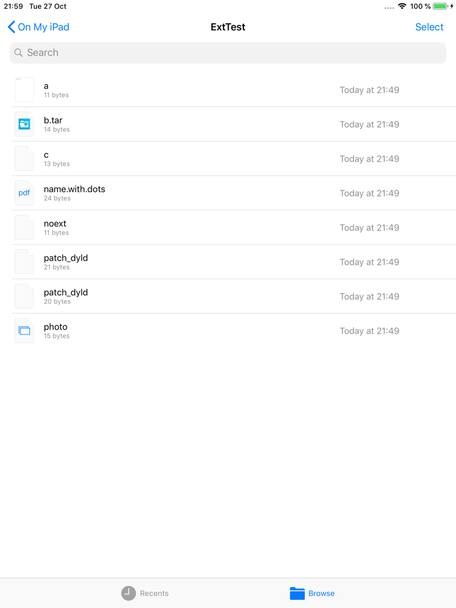
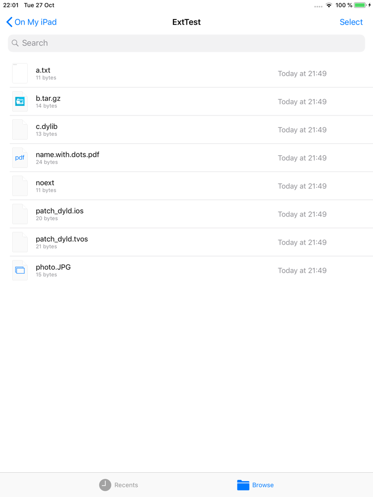
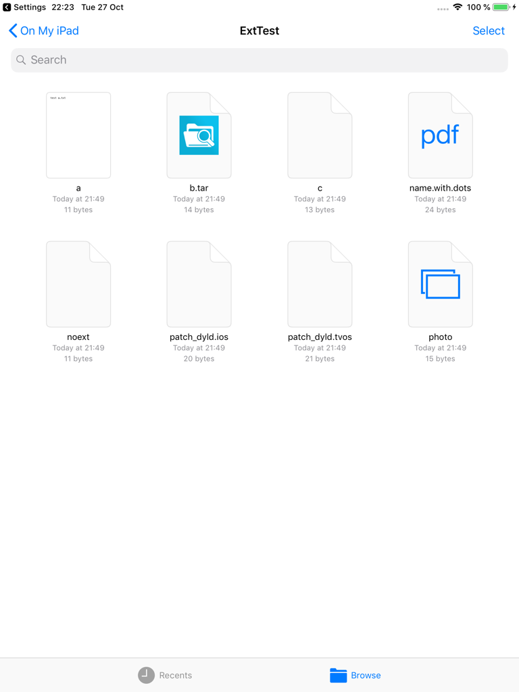
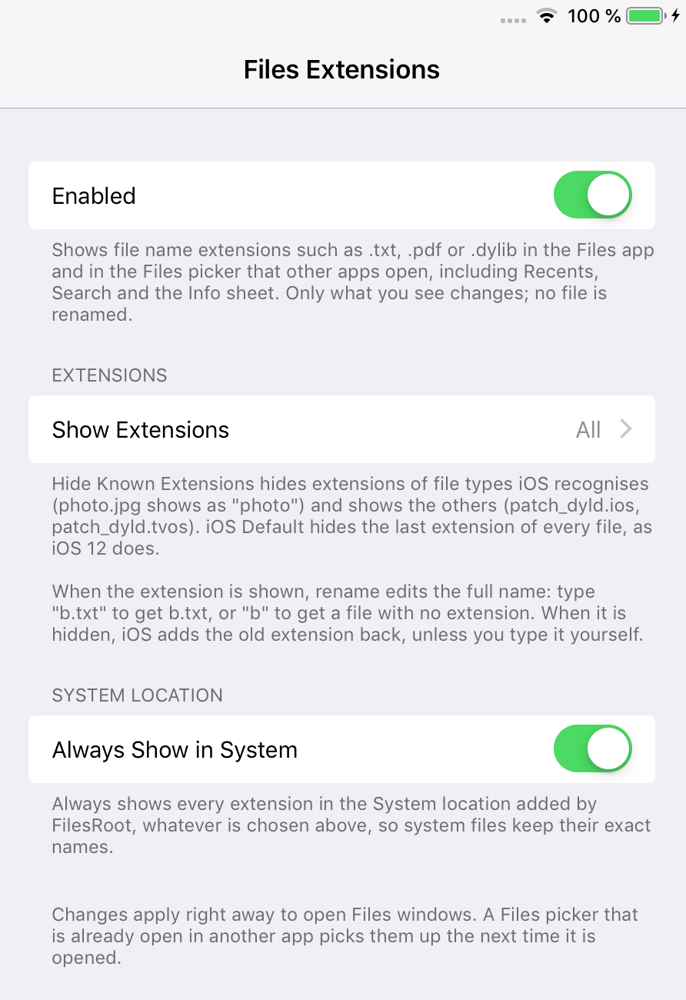

<p align="center"></p>

<h1 align="center">FilesExtensions (iOS 12)</h1>

**Shows file name extensions in the Files app on iOS 12.**

iOS 12's Files app drops the last extension of every file, whatever it is. `a.txt` shows as "a", and `patch_dyld.ios` and `patch_dyld.tvos` both show as "patch_dyld", so you can't tell them apart. FilesExtensions shows the full names. You can also hide only the extensions iOS knows, like the Finder on a Mac, or keep the iOS behaviour.

Only what you see changes. No file is renamed.

This is an unofficial jailbreak tweak. It is not affiliated with or endorsed by Apple.

## Screenshots

| Before (iOS 12) | After (Show All Extensions) |
| --- | --- |
|  |  |

Hide Known Extensions: only the extensions iOS doesn't recognise stay visible:



Settings > Files Extensions:



## Features

- **Three modes:**
  - **Show All Extensions** (default): every file shows its full name.
  - **Hide Known Extensions:** hides the extensions of file types iOS recognises (`photo.jpg` shows as "photo") and shows the others (`patch_dyld.ios`), like the Finder on a Mac.
  - **Hide All Extensions (iOS Default):** the normal iOS 12 behaviour.
- **Works everywhere names are shown:** every location (On My iPad, iCloud Drive, other file providers, the System location of [FilesRoot](https://github.com/itsAllexB/FilesRoot-iOS12)), list and icon view, Recents, Search, the Info sheet, the Files picker and "Save to Files" that other apps open, and the Files recents popover in the Dock.
- **Rename edits the full name** when the extension is shown: renaming `a.txt` to `b.txt` gives `b.txt`, and to `b` gives a file with no extension. When the extension is hidden, iOS adds the old extension back as usual, but typing it yourself no longer doubles it (`b.txt`, not `b.txt.txt`).
- **Always Show in System:** FilesRoot's System location can always show every extension, whatever mode you choose, so system files keep their exact names.
- Changes apply right away to open Files windows. No respring needed.

## Compatibility

- Tested on an iPad mini 2 with iOS 12.5.8, jailbroken with checkra1n + odysseyra1n (Procursus, libhooker).
- Expected to work on iOS 12.x. It should work on iPhone too, but it has only been tested on iPad.
- Works alongside [FilesRoot](https://github.com/itsAllexB/FilesRoot-iOS12) and [FilesArchiver](https://github.com/itsAllexB/FilesArchiver-iOS12).

## Install

Add the **iOS Legacy** source to your package manager, then search for FilesExtensions:

```
https://itsallexb.github.io/ios-legacy/
```

One tap on your device: [Add to Sileo](https://itsallexb.github.io/ios-legacy/add/sileo.html) · [Add to Zebra](https://itsallexb.github.io/ios-legacy/add/zebra.html) · [Add to Cydia](https://itsallexb.github.io/ios-legacy/add/cydia.html)

Or download the `.deb` from [Releases](https://github.com/itsAllexB/FilesExtensions-iOS12/releases/latest) and install it with Filza or `dpkg -i`, then reopen Files.

Requires `mobilesubstrate` (Substrate, Substitute or libhooker) and PreferenceLoader. Your package manager installs them automatically.

## Settings

Open **Settings > Files Extensions**:

- **Enabled**: turns the tweak on or off.
- **Show Extensions**: *Show All Extensions* (default), *Hide Known Extensions* or *Hide All Extensions (iOS Default)*.
- **Always Show in System** (on by default): always shows every extension in FilesRoot's System location, whatever is chosen above.

A Files picker that is already open in another app picks up changes the next time it is opened.

## Known limits

- Recents and Search come from the Spotlight index. On the test iPad both stayed empty with or without the tweak, so they couldn't be checked on the device. They use the same name as everywhere else.
- "Hide Known Extensions" depends on which file types iOS knows. For example, `.dylib` and `.gz` count as known.
- In the hiding modes only the last extension is hidden: `b.tar.gz` shows as "b.tar", as on stock iOS.

## Build from source

You need [Theos](https://theos.dev/docs/installation) and an iOS SDK (the Makefile uses the iOS 14.5 SDK and targets iOS 12.0, arm64).

```sh
git clone https://github.com/itsAllexB/FilesExtensions-iOS12.git
cd FilesExtensions-iOS12
make package FINALPACKAGE=1
```

The package is written to `packages/`. To install it on a device over SSH, set `THEOS_DEVICE_IP` and run `make install`.

How it works: iOS 12 gets every file name it shows from `-[FPItem displayName]` in FileProvider.framework. When the provider gives no display name, that method calls `stringByDeletingPathExtension` on the file name, for every file. FilesExtensions hooks that one getter, so every place and every process that shows file names is covered. It also hooks `-[FPRenameOperation initWithItem:newName:]`, so a rename keeps the name you typed, and `-[DOCItemInfoViewController updatePrimaryTitleWithItem:]`, so the Info sheet doesn't show the extension twice. It loads into Files, the document picker service and the Dock recents popover. See the comments in [`Tweak.x`](Tweak.x).

## Credits and license

Made by [itsAllexB](https://github.com/itsAllexB).

FilesExtensions is free software under the GNU General Public License v3.0 or later. See [LICENSE](LICENSE).

iPad, iPhone, Files and Finder are trademarks of Apple Inc. This project is not affiliated with Apple.
